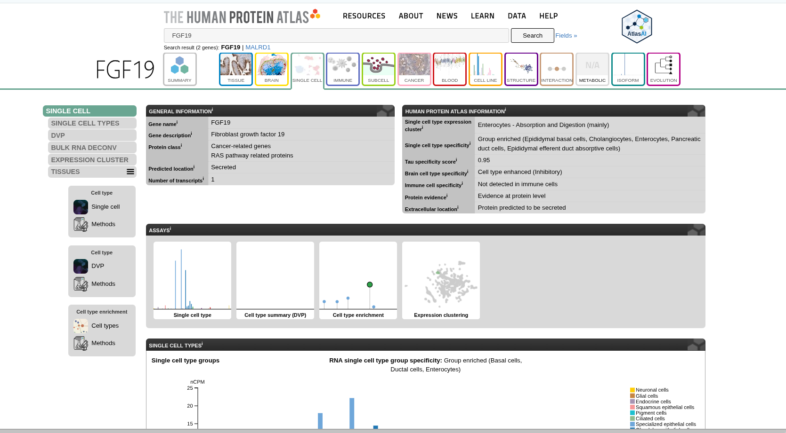
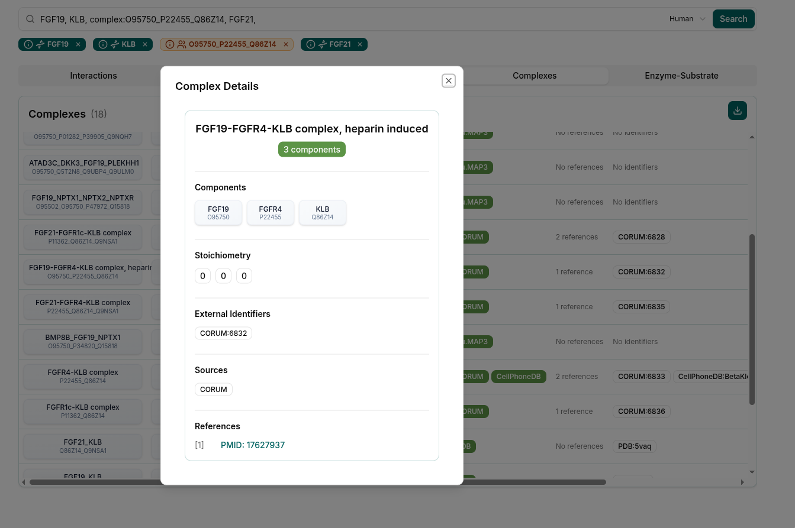
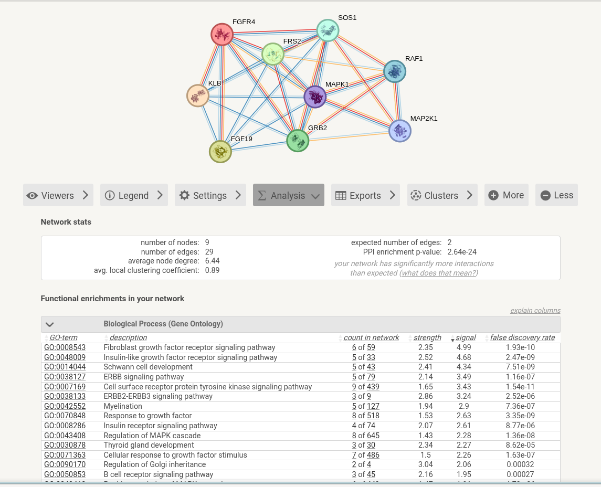
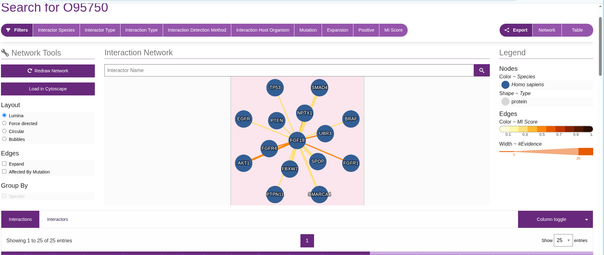
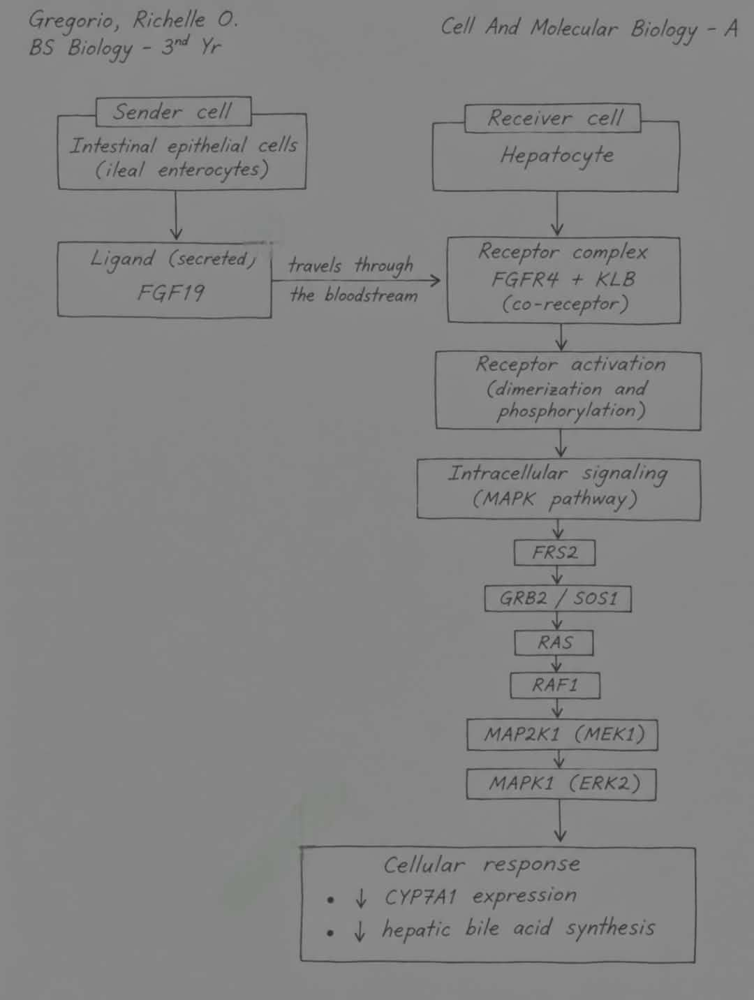

# FGF19–FGFR4–KLB-Mediated Cell-to-Cell Communication in Hepatic Bile Acid Regulation

**Individual Cell-to-Cell Communication Laboratory**  
**Course:** Cell and Molecular Biology  
**Student:** Gregorio, Richelle O.  
**Organism:** *Homo sapiens*

## Introduction

Cell-to-cell communication allows different cells and organs to coordinate their functions through signaling molecules. In this laboratory activity, I investigated how intestinal epithelial cells communicate with hepatocytes through the FGF19–FGFR4–KLB signaling system.

FGF19 is an endocrine signaling protein produced by intestinal epithelial cells, particularly ileal enterocytes. After secretion, it travels through the portal bloodstream to the liver, where it interacts with FGFR4 and its co-receptor KLB on hepatocytes. This signaling system contributes to the regulation of CYP7A1 expression and hepatic bile acid synthesis.

The investigation used the Human Protein Atlas, OmniPath, STRING, IntAct and UniProt to examine ligand expression, receptor interactions, intracellular signaling proteins, and experimental evidence.

### Biological Question

How do intestinal epithelial cells communicate with hepatocytes through FGF19–FGFR4–KLB signaling to regulate hepatic bile acid synthesis?

The proposed communication follows this general sequence:

**Intestinal epithelial cells → FGF19 secretion → Portal bloodstream → FGFR4–KLB receptor system on hepatocytes → Intracellular signaling → Reduced CYP7A1 expression → Decreased hepatic bile acid synthesis**

---
## I. Sender Cell Selection

**Selected sender cell:** Intestinal epithelial cells  
**Specific cell type:** Ileal enterocytes  
**Tissue:** Small intestine, particularly the ileum

Intestinal epithelial cells were selected because they participate in nutrient absorption, intestinal barrier protection, and communication with other tissues. Ileal enterocytes can respond to bile acids and produce FGF19, which helps coordinate bile acid metabolism between the intestine and liver.

## II. Identification of the Signaling Molecule

**Ligand:** FGF19 (Fibroblast growth factor 19)  
**UniProt accession:** O95750  
**Signaling type:** Endocrine

The Human Protein Atlas identified FGF19 as having group-enriched RNA expression in several cell types, including enterocytes. Its single-cell expression cluster was associated with enterocytes involved in absorption and digestion. FGF19 was also annotated as a secreted protein.

**Figure 1.** _The presence of FGF19 RNA expression in enterocytes supports the selected sender cell. However, RNA expression alone does not confirm active protein secretion under every physiological condition.
_

---
## III. Identification of the Receptor and Receiver Cell

**Primary receptor:** FGFR4 (Fibroblast growth factor receptor 4)  
**Co-receptor:** KLB (β-Klotho)  
**Receiver cell:** Hepatocyte  
**Receiving tissue:** Liver

FGFR4 is a receptor tyrosine kinase that transmits extracellular signals into the receiving cell. KLB acts as an important co-receptor that facilitates physiological FGF19 signaling. OmniPath Explorer identified a directed interaction between FGF19 (O95750) and FGFR4 (P22455), classified as post-translational and supported by seven publications. Further investigation identified the **FGF19–FGFR4–KLB complex, heparin induced**, containing FGF19, FGFR4, and KLB (Q86Z14). The complex was annotated in CORUM under identifier **CORUM:6832**, with supporting publication PMID: 17627937. Hepatocytes were selected as receiver cells because they express the relevant receptor components and are responsible for hepatic bile acid synthesis.

**Figure 2. OmniPath Interaction** _OmniPath supports the proposed ligand–receptor relationship and the inclusion of KLB as a co-receptor. However, the curated complex was reported under heparin-induced conditions, and these records do not independently demonstrate signaling in every hepatocyte.
_

---
## IV. STRING Protein Network Analysis

A protein association network was generated using **STRING v12.5** for *Homo sapiens*. Nine proteins were included:

**FGF19, FGFR4, KLB, FRS2, GRB2, SOS1, RAF1, MAP2K1, and MAPK1.**

### Network Statistics

| Parameter | Result |
|---|---|
| Nodes | 9 |
| Edges | 29 |
| Expected edges | 2 |
| Average node degree | 6.44 |
| Clustering coefficient | 0.89 |
| PPI enrichment p-value | 2.64 × 10^-24 |

The network showed significantly more functional associations than expected by chance, suggesting that the selected proteins participate in related biological processes.

### Selected Functional Enrichment Results

| Database | Enriched pathway | FDR |
|---|---|---|
| GO | FGF receptor signaling (GO:0008543) | 1.93e-10 |
| GO | Regulation of MAPK cascade (GO:0043408) | 1.36e-08 |
| GO | Regulation of bile acid biosynthesis (GO:0070857) | 0.0018 |
| Reactome | Signaling by FGFR4 | 8.76e-15 |
| Reactome | FRS-mediated FGFR4 signaling | 3.19e-14 |
| Reactome | β-Klotho-mediated ligand binding | 6.81e-09 |
| KEGG | MAPK signaling pathway | 7.08e-10 |

Five intracellular proteins were selected to explain the proposed signaling mechanism: **FRS2, GRB2, SOS1, MAP2K1, and MAPK1**, with RAF1 included as an additional intermediate.
The fibroblast growth factor receptor signaling pathway is directly relevant to FGFR4 activation. The MAPK- and ERK-associated terms support the relevance of the selected intracellular signaling proteins. The enrichment of regulation of bile acid biosynthetic process is especially important because the proposed physiological response involves the control of hepatic bile acid synthesis. However, this particular biological process includes only two network proteins, and the enrichment does not independently establish whether bile acid synthesis is increased or decreased.

**Figure 3. STRING Protein Association Network** _The network and enrichment results support functional relationships involving FGFR4 signaling, MAPK-related signaling, and bile acid regulation. However, STRING associations do not necessarily represent direct physical binding or establish pathway direction._

**STRING network:**  
https://string-db.org/cgi/network?taskId=bTYzhN7F0rKS&sessionId=bazWqw8cSQP1

---
## V. IntAct Molecular Interaction Validation

The interaction between FGF19 and FGFR4 was examined using the IntAct database.

| Parameter | Result |
|---|---|
| Protein pair | FGF19–FGFR4 |
| UniProt accessions | O95750–P22455 |
| Organism | *Homo sapiens* |
| Detection method | Solid-phase assay |
| Interaction type | Direct interaction |
| Experimental context | In vitro |
| IntAct accession | EBI-15801053 |
| MI Score | 0.44 |
| Publication | PMID: 19706524 |

**Figure 4. IntAct Experimental Interaction Evidence** _IntAct provides experimental evidence supporting direct binding between FGF19 and FGFR4 under the tested in vitro conditions. The record does not independently demonstrate the complete signaling mechanism in living hepatocytes._ Although KLB was not part of this specific two-protein IntAct record, its role as a co-receptor is supported by the OmniPath complex annotation and published research.

---
## VI. Final Cell-to-Cell Communication Model

The proposed signaling mechanism follows this sequence:

**Intestinal epithelial cells → FGF19 → Portal bloodstream → FGFR4/KLB on hepatocytes → FRS2 → GRB2/SOS1 → RAS → RAF1 → MAP2K1 → MAPK1 → Reduced CYP7A1 expression → Decreased hepatic bile acid synthesis**

**Figure 5. Proposed FGF19–FGFR4–KLB Communication Model**

### Figure Interpretation 

The proposed model illustrates endocrine communication between intestinal epithelial cells and hepatocytes in the regulation of bile acid synthesis. Intestinal epithelial cells, particularly ileal enterocytes, produce and secrete fibroblast growth factor 19 (FGF19). This signaling molecule travels through the portal bloodstream to the liver, where it interacts with FGFR4 and its co-receptor KLB on hepatocytes. The Human Protein Atlas supports FGF19 expression in enterocytes and provides expression evidence for FGFR4 and KLB in the liver. OmniPath identified a directed FGF19–FGFR4 interaction and an FGF19–FGFR4–KLB complex (CORUM:6832). STRING analysis revealed significant functional associations among nine selected proteins (PPI enrichment p-value = 2.64 × 10^-24), including enrichment of FGFR4 signaling, MAPK signaling, and regulation of bile acid biosynthesis. IntAct also provided experimental evidence of direct FGF19–FGFR4 binding through a solid-phase assay (PMID: 19706524). Based on established signaling biology, receptor activation may involve FRS2, GRB2, SOS1, RAF1, MAP2K1, and MAPK1. This signaling contributes to reduced CYP7A1 expression and decreased hepatic bile acid synthesis. However, the database associations do not independently establish every intracellular step or prove that the complete pathway operates under all physiological conditions. Overall, the evidence supports a biologically plausible mechanism linking intestinal signaling to liver bile acid regulation.

---

## Questions and Answers

### 1. What sender cell did you choose, and in what biological context does it act?

I selected intestinal epithelial cells, particularly ileal enterocytes. These cells participate in intestinal absorption and help regulate hepatic bile acid synthesis through the production of FGF19.

### 2. What signaling molecule did you identify, and what evidence supports its production?

The signaling molecule is FGF19. The Human Protein Atlas reports FGF19 RNA expression in enterocytes and identifies the protein as secreted, supporting its selection as an intestinal epithelial signaling molecule.

### 3. What receptor receives the signal, and which receiver cell did you select?

FGFR4 receives the FGF19 signal with the assistance of its co-receptor KLB. The selected receiving cells are hepatocytes, which participate in bile acid synthesis and possess the relevant receptor system.

### 4. What type of signaling is represented?

Endocrine signaling, because FGF19 travels through the bloodstream from the intestine to the liver.

### 5. Which proteins in your STRING network are most relevant to the receptor-associated response?

FRS2, GRB2, SOS1, MAP2K1, and MAPK1 were selected because they participate in receptor-associated signaling and the MAPK pathway. RAF1 is also included as a signaling intermediate.

### 6. Which enriched pathway is consistent with the proposed mechanism?

The FGF receptor signaling pathway (GO:0008543), Signaling by FGFR4 (Reactome), and MAPK signaling pathway (KEGG) are relevant. Regulation of bile acid biosynthesis (GO:0070857) also supports the biological context.

### 7. What did IntAct show for the molecular interaction?

IntAct identified a direct interaction between FGF19 and FGFR4 using a solid-phase assay under in vitro conditions, supported by publication PMID: 19706524.

### 8. Which findings are strongly supported, and which remain inferred?

FGF19 expression, the curated receptor complex, and the direct FGF19–FGFR4 interaction are supported by database and experimental evidence. The complete intracellular signaling sequence remains partly inferred from established pathway biology and is not independently proven by STRING.

### 9. What cellular response is expected, and why?

The expected response is decreased CYP7A1 expression and reduced hepatic bile acid synthesis. This contributes to the negative-feedback regulation of bile acid production and helps maintain bile acid homeostasis.

---

## Limitations
The investigation integrates evidence from multiple databases and published studies rather than directly observing the complete pathway in living human cells. Gene expression does not always indicate active signaling, STRING associations do not necessarily represent physical binding, and the selected IntAct interaction was observed in vitro. Therefore, the final model is a biologically supported proposal rather than direct experimental proof of every intracellular step.

---
## Conclusion
This investigation supports an endocrine communication system in which intestinal epithelial cells produce FGF19, allowing the intestine to communicate with hepatocytes through FGFR4 and its co-receptor KLB. Evidence from the Human Protein Atlas, OmniPath, STRING, and IntAct supports the proposed ligand–receptor system and relevant intracellular signaling mechanisms. Together with published biological studies, these findings explain how intestinal signaling contributes to the regulation of hepatic bile acid synthesis.

---
## References

https://www.proteinatlas.org/ENSG00000162344-FGF19
https://www.proteinatlas.org/ENSG00000160867-FGFR4
https://www.proteinatlas.org/ENSG00000134962-KLB
https://www.uniprot.org/uniprotkb/O95750/entry
https://www.uniprot.org/uniprotkb/P22455/entry
https://www.uniprot.org/uniprotkb/Q86Z14/entry
https://explore.omnipathdb.org/
https://mips.helmholtz-muenchen.de/corum/
https://string-db.org/
https://string-db.org/cgi/network?taskId=bTYzhN7F0rKS&sessionId=bazWqw8cSQP1
https://www.ebi.ac.uk/intact/
https://pubmed.ncbi.nlm.nih.gov/17627937/
https://doi.org/10.1073/pnas.0907812106

